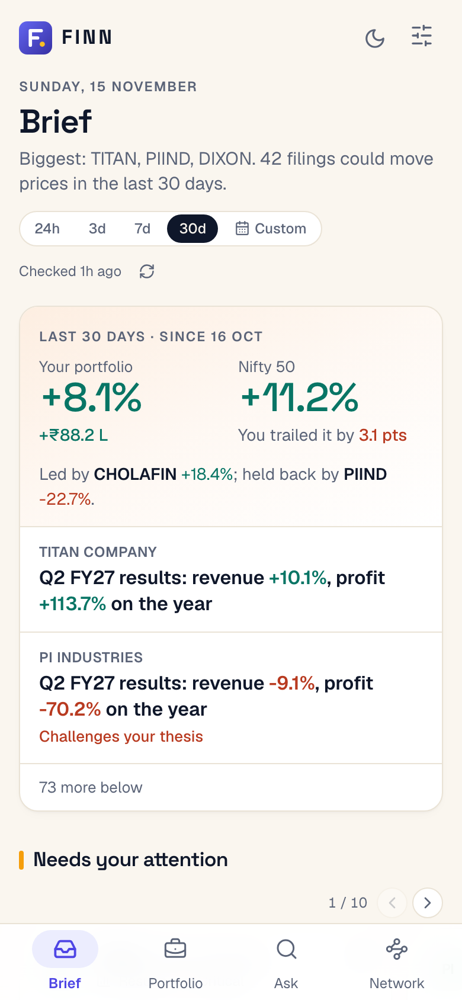
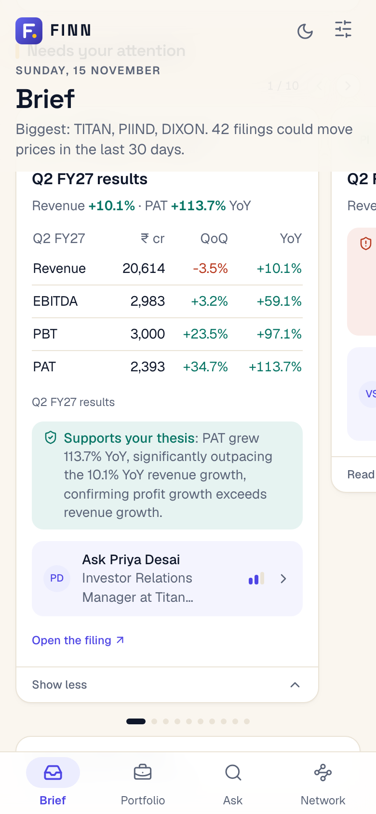
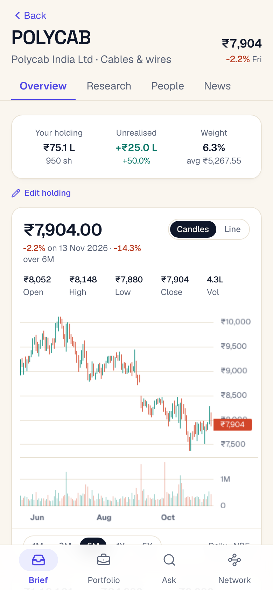
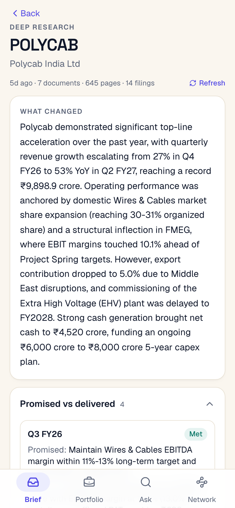
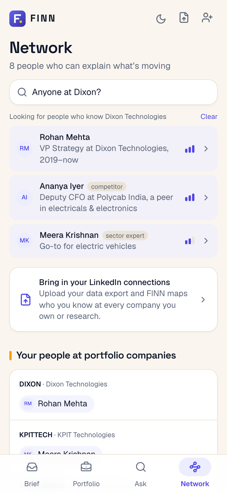

# FINN: Financial Investment Agent

A mobile-first investing companion built for the ENAM Holdings Founding AI Engineer build challenge.

**Live demo: <LIVE_URL>** (open it on a phone, or use your browser's phone view)

FINN is a briefing, not a dashboard. It answers *"what changed, does it matter, and who can tell me more?"* in under a minute:

- **Push (Brief):** every filing across the portfolio for the window you pick, ranked, with only price-moving items up top and routine ones collapsed. Results come with QoQ / YoY numbers, management changes with the person's background, material events with the best person to call. Configurable price and volume alerts, a calendar of what's coming, your thesis checked against every filing, and Web Push notifications.
- **Pull (Ask):** any NSE company. Fundamentals computed from statements, "ask anything" answered from transcripts and annual reports with page citations, and a 30–60 s deep-research report with *promised vs delivered* over the last four quarters.
- **Network:** woven into both. Who you know at the company, a competitor or in the sector; second-degree paths to new management; an expertise map; reasons to reconnect. Built from your own LinkedIn export, never scraping.

<p>





</p>

**A two-minute tour:** open the Brief and switch the window to *30d* → swipe the deck and open the Titan results card (numbers, thesis verdict, who to ask) → tap a company → *Research* → *Open deep research* → *Network* → ask "Anyone at Dixon?".

**Docs:** [Architecture](docs/ARCHITECTURE.md) (pipelines, privacy, LLMs, cloud) · [Product decisions](docs/PRODUCT.md) · [AI build history](docs/build-history/) · [Deploying](DEPLOY.md) · [The brief](docs/brief/)

## Run it

Needs Node 20+, pnpm and [uv](https://docs.astral.sh/uv/).

```bash
make setup             # install web + api deps
cp .env.example .env   # optional: add a free GEMINI_API_KEY
make ingest-all        # pull real data for the portfolio (~1 min)
make ingest T=POLYCAB  # one company in depth, incl. transcripts + annual report
make api               # FastAPI on :8000   (terminal 1)
make web               # Next.js on :3000   (terminal 2)
make test              # API tests (offline)
make check             # tests + ruff + typecheck + eslint
```

Without ingestion, the app runs on synthetic fixtures. `GET /data/{ticker}` on the API shows everything stored for a company.

Open http://localhost:3000. Use your browser's device toolbar (phone width), or open it from a phone on the same Wi-Fi at `http://<your-lan-ip>:3000`.

## Layout

```
api/                        FastAPI backend (Python, uv)
  app/models.py             API contract (mirrored in web/src/lib/types.ts)
  app/routers/              push · pull · network · portfolio
  app/services/
    digest.py               Push: rank → enrich → weave network → collapse routine
    materiality.py          Can this filing move the price? (rules + the move beyond the Nifty)
    titles.py               Filing boilerplate → short card titles
    thesis.py               Each material filing judged against your thesis
    notify.py               Web Push (VAPID) for what crosses your thresholds
    priority.py taxonomy.py Scoring + announcement categories (from the ENAM glossary)
    graph.py                Network: inferred edges, who-knows-company, second-degree reach, themes, reconnect
    research.py             Pull: section pipeline (primary sources only)
    watch.py                Auto-refresh of the portfolio (every 15 min) + refresh on demand
    qa.py                   Ask a company a question: retrieval over its documents + cited answer
    deep_research.py        30–60 s cited research job (movements, promised vs delivered, bull/bear, questions)
    network_query.py        Direct network questions, insider paths, person dossier
    market.py               Prices for charts + value-weighted portfolio vs Nifty 50 (on-demand fetch, 6h cache)
    fundamentals.py         Deterministic analysis: snapshot, trajectory, balance sheet, cash quality, shareholding
    news.py                 Company headlines (Google News RSS, 3h cache)
    filing_people.py        People named in filings → Person records for UI + graph
    connections.py          Your connections: LinkedIn export import (sync), add/remove by hand
    company_people.py       Management + board per company, merged across sources, matched to your network
  app/ingest/               Data pipeline (python -m app.ingest): nse, eod, screener, documents, classify, enrich
  app/llm.py                Model routing (cheap / strong), SQLite-cached, Gemini or OpenAI-compatible
  app/data/                 portfolio.json, network/people.json, fixtures/ (synthetic)
  tests/
web/                        Next.js 15 App Router, Tailwind, mobile-first
  src/app/                  /  (Brief)  /portfolio  /ask  /company/[ticker]  /network  /people/[id]  /settings
  src/components/           BriefCard, SwipeDeck, Today, ComingUp, PriceChart, NetworkLine, …
  src/lib/                  api client, types, formatters
docs/                       brief PDFs, product + architecture notes, screenshots, AI build history
```

## Data status

| Layer | Source | Status |
|---|---|---|
| Announcements | NSE corporate-announcements API (+ attachment PDFs / SEBI XBRL zips) | Live |
| EOD prices | Yahoo Finance via yfinance (`.NS`) | Live |
| Fundamentals | screener.in tables + document links → BSE-hosted ARs / concall transcripts | Live |
| News | Google News RSS (secondary, context only, never used in research) | Live |
| Holdings | `api/app/data/portfolio.json` (qty, avg cost, buy date) | Demo |
| Network: your connections | Your LinkedIn export (upload in Network → ⤒) + people you add | Live |
| Network: company leadership | Yahoo Finance officers + NSE governance XBRL + exchange filings | Live |
| Network: demo people | Synthetic profiles in `data/network/people.json` (`FINN_DEMO_NETWORK=0` to hide) | Demo |

To try the import without your own export, upload `api/app/data/network/sample_linkedin_connections.csv` (made-up people at real companies).
