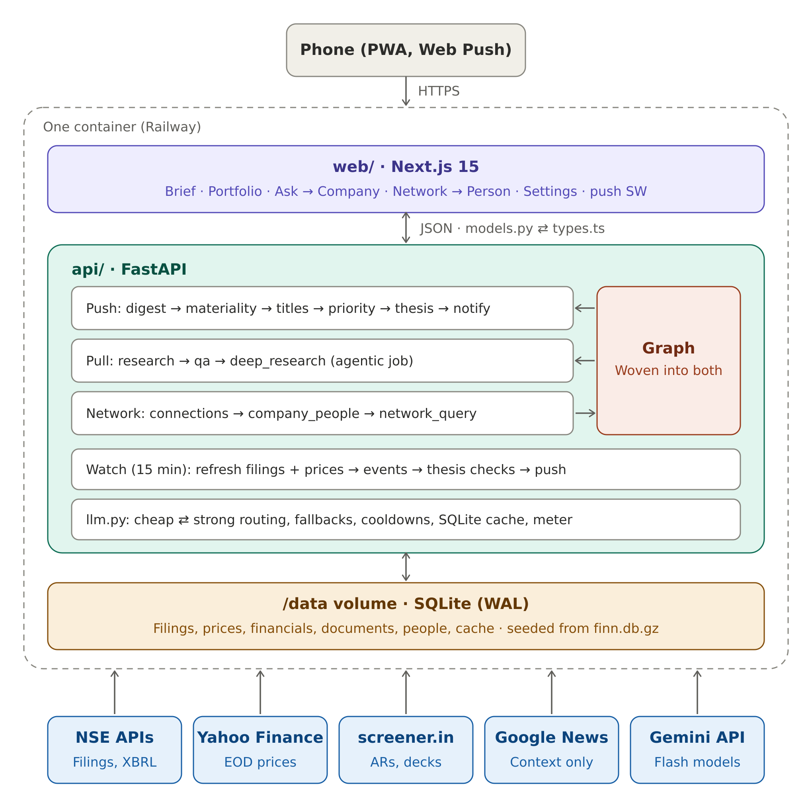

# FINN: architecture

The brief asks for four topics: **data pipelines**, **security & privacy**, **LLMs & agents** and **cloud**. The short
version is in the covering email; this is the long form.

## Data pipelines

`python -m app.ingest TICKER` (or `--portfolio`), and the in-process watcher every 15 minutes for the portfolio. Each
source is its own step, so one failing never blocks the rest. Everything is upserted (idempotent re-runs); documents are
fetched once, cached by URL and stored page by page so answers can cite pages.

| Source | Fetch | Store | Refresh |
|---|---|---|---|
| Announcements | NSE corporate-announcements API; attachment PDF or zip (PDF + SEBI XBRL) only when needed | `announcements`, `documents`, `doc_pages` | 15 min |
| Event calendar | NSE board-meeting calendar, corporate actions, forward-looking notices | `events` | 15 min |
| EOD prices | yfinance `TICKER.NS` and Nifty 50; today's bar dropped until 15:45 IST | `eod` | 15 min, 6h cache for charts |
| Fundamentals | screener.in (consolidated, else standalone): 13 quarters + 10 years P&L / BS / CF / shareholding | `companies`, `financials` (long format) | daily |
| Transcripts, decks, ARs | BSE-hosted PDFs linked from screener; only the ~30 most relevant AR pages kept | `documents`, `doc_pages` | on demand (deep research) |
| Leadership | Yahoo Finance officers + NSE corporate-governance XBRL + appointments in filings | `company_people` | weekly |
| Your connections | Your LinkedIn data export (CSV / zip), or added by hand | `people` | when you upload |
| News | Google News RSS, filtered for price relevance and de-duplicated | `news` | 3h |

**Classification: cheapest layer first.** Measured on 1,352 real announcements across the 18-company portfolio: NSE's
own label plus text rules settle ~85% for free; the cheap model (batched 25 per call, cached) handles the rest and
writes a one-line summary where the exchange line says nothing ("Updates" → what happened). A `routine` flag demotes
business-as-usual items inside material categories (an NBFC's weekly NCD allotment).

**Can it move the price?** (`services/materiality.py`, no model) Results, CEO / MD / CFO / Chair changes, real deals,
fund raises, rating moves, promoter dealing, orders and clarifications, litigation: yes. Divisional and independent-
director appointments, rating reaffirmations, subsidiary paperwork, awards and launches: no. When the rules can't tell,
the session's move beyond the Nifty decides (≥3%). Only price-sensitive items reach the top of the Brief.

**Enrichment.** Results → Revenue / EBITDA / PBT / PAT with QoQ and YoY for the quarter the filing names (recomputed at
read time, so numbers appear as soon as the quarter lands). Management change → the person, best source first: SEBI XBRL
(exact) → the cheap model over the filing PDF (which by SEBI rule carries the appointee's profile) → regex. Titles are
cleaned deterministically ("A press release dated…, titled", "(designated as …)", legal boilerplate).

**Linking a name in a filing to the network.** Employers and schools are normalised (`Havells India Ltd.` = `Havells`,
resolved to an NSE ticker where possible), then two people are linked when their tenure at the same employer, or their
years at the same school, overlap. Link strength comes from overlap length, closeness and recency of contact. Every
suggestion says why ("worked at Polycab 2016–2020, overlapping your contact's time in finance").

## Security & privacy

- **What's stored about a person:** name, role, employer, tenure, school, expertise tags, how the investor knows them, and
  when they last spoke. No emails, phone numbers or message content; email addresses in a LinkedIn export are dropped on read.
- **Where it comes from, all permissible:** the investor's own LinkedIn data export (uploaded by them); people they add by
  hand; public company records (Yahoo Finance officers, NSE governance XBRL, exchange filings). FINN never logs into or
  scrapes LinkedIn. The demo network is synthetic, and the public demo disables uploads so no visitor's data is visible to the next.
- **What reaches a model:** no connection data, ever. Who-to-call, second-degree paths, the expertise map and network
  questions are deterministic graph queries. The only personal text a model reads is a public filing announcing an appointment.
- **Retention and control:** re-uploading an export is a full sync (people you removed on LinkedIn disappear); the whole
  import can be removed in one tap; any connection can be deleted from their page. Leadership records carry their source.
  The bundled demo snapshot is built by a script that strips connections, contact logs, push subscriptions and signing keys.
- **In a real deployment:** per-investor tenancy (row-level `owner_id` in Postgres; nothing shared across users, even inside
  a firm, unless explicitly shared), SSO, encryption at rest, an audit log of who viewed which profile, a consent note at
  import, retention limits for people no longer in the investor's export, and a data-processing agreement with the model
  provider (or a self-hosted model) before any filing text leaves the box.

## LLMs & agents

| Step | Model | Why |
|---|---|---|
| Classify filings | None for ~85%; Flash-Lite, batched 25/call, for the rest | Bulk, cheap, cacheable |
| One-line summary of a vague filing | Flash-Lite, one batched call per company per refresh | The exchange line is often just "Updates" |
| Who joined / left, with their profile | SEBI XBRL when present (no model); else Flash-Lite over the PDF | Structured beats generated |
| Price-sensitivity, results numbers, titles, fundamentals, movements | None | Rules and arithmetic; a model only adds risk |
| Thesis check ("supports / challenges your thesis") | Flash-Lite, one batched call per company per day | Short judgement over a filing summary |
| Ask a company a question | Lexical retrieval over page-indexed documents (no embeddings), one Flash-Lite call over ~8 pages | ~5k tokens; cites pages; says when the documents don't answer |
| Deep research synthesis | One Flash call over extracted facts, not raw documents | Reasoning only where it's needed |
| Network (who to call, paths, questions, dossier) | None | Explainable, and no personal data leaves the box |

**The one agent: deep research** (`services/deep_research.py`). It runs a fixed plan over a company's primary sources,
calls tools (exchange APIs, PDF readers, the model) and assembles a page-cited report:

| Stage | What | Model calls | Time |
|---|---|---|---|
| collect | 12 months of filings, prices, fundamentals, leadership | 0 | 5–10 s |
| documents | last 4 transcripts, 2 decks, latest annual report (most relevant ~30 pages) | 0 | 1–10 s |
| movements | financial inflections, events and the next session's reaction, people, ownership, unexplained moves | 0 | <1 s |
| extract | one cheap call per document + one for filings, page-cited JSON | ~8 Flash-Lite | 10–45 s |
| synthesize | promised vs delivered, guidance, themes, risks, bull / bear, questions routed to people in your network | 1 Flash | 5–40 s |

A first run is ~90k input / ~8k output tokens (≈ $0.01–0.02 at paid prices; ~9 requests against free-tier quotas). Every
call is cached by (model, prompt, input hash): a re-run with no new documents makes 0 calls; a new quarter re-reads only
the new transcript plus one synthesis. Pull stays grounded: the research view never sees news or the model's own
knowledge, and every claim cites a document page.

**Routing** (`app/llm.py`): cheap tier `gemini-3.5-flash-lite`, strong tier `gemini-3.5-flash`, each with a fallback
chain. An overloaded model (503 / timeout) is skipped for 10 minutes; a daily-quota error skips it for 6 hours; each stage
has a wall-clock budget, so a slow provider degrades a report (noted at the bottom) instead of blocking it. Any
OpenAI-compatible endpoint can replace Gemini through environment variables.

## Cloud

| Piece | Where | Why |
|---|---|---|
| Web (Next.js standalone) + API (uvicorn) | One Docker container on Railway, with a persistent `/data` volume | SQLite and the PDF cache need a disk; deep research and the 15-minute watcher need a long-lived process, which serverless functions don't give |
| Store | SQLite in WAL mode → Postgres for multi-user | One investor; zero ops |
| Scheduled work | In-process watcher (`services/watch.py`) | Refresh → events → thesis checks → notifications, without a separate queue |
| Notifications | Web Push (VAPID, RFC 8292) via the browser's push service | Works on Android and installed iOS PWAs; no app store |
| Models | Gemini free tier, via one routing module | Flash-Lite for bulk, Flash for synthesis |

Measured on the deployed container: ~103 MB idle, ~254 MB peak (heavy libraries load lazily; `MALLOC_ARENA_MAX=2`).
At scale: Postgres, a worker queue for ingestion and deep research, object storage for PDFs, and the API split from the
web tier.
